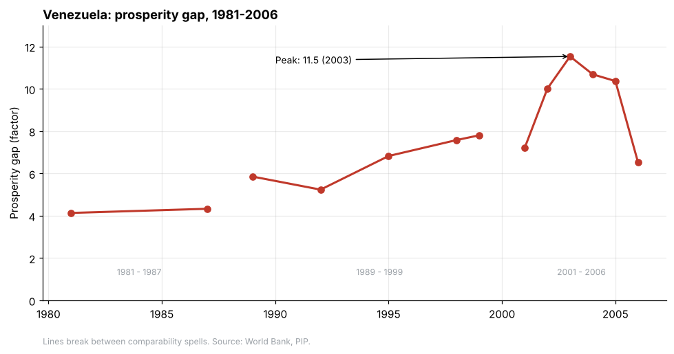
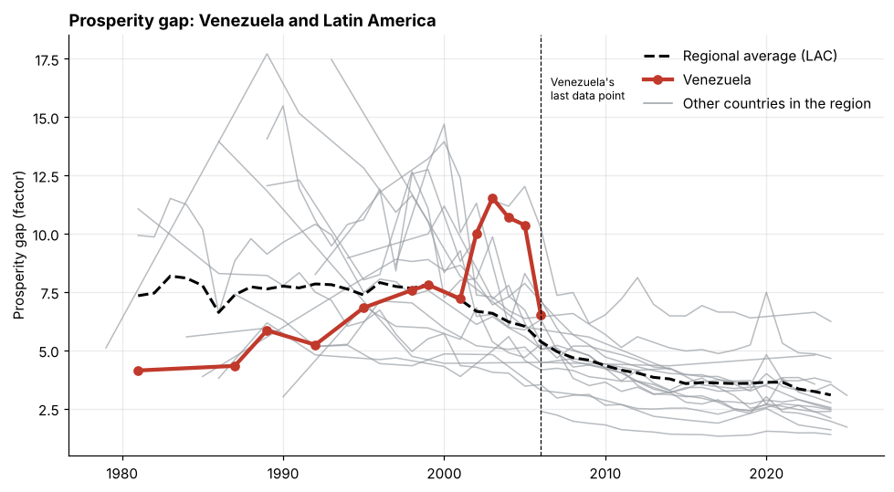
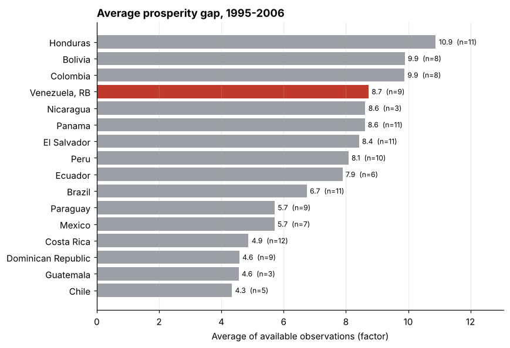

# Prosperity Gap in Venezuela (1981-2006) vs. Latin America

An exploratory analysis of World Bank data on how far Venezuela's population was from a prosperity-level income, and how that compares with the rest of Latin America.

**Tools:** Python · pandas · matplotlib · Jupyter · SQL (SQLite) · Tableau Public
**Source:** [Poverty and Inequality Platform (PIP), World Bank](https://pip.worldbank.org/)

**[View the interactive dashboard on Tableau Public](https://public.tableau.com/app/profile/pamela.reyes5086/viz/Libro1_17942712345210/Dashboard1)**

---

## Research question

How did the prosperity gap in Venezuela evolve between 1981 and 2006, and how does it compare with the rest of Latin America?

## What is the Prosperity Gap?

It is the **average factor by which people's incomes would need to be multiplied** to reach the World Bank's prosperity standard (about US$25 a day in purchasing power parity terms). The higher the value, the further the population is from that standard. A value of 10 means incomes would need to increase tenfold, on average.

## Key findings



- **1981:** Venezuela started well below the regional average (4.1 vs. 7.3 for Latin America and the Caribbean).
- **1999:** the two were practically level at around 7.8.
- **2003:** Venezuela's gap rose **47.8%** from 1999 to a peak of **11.5**, almost 5 points above the regional average (6.6).
- **2006:** last available data point. It fell **43.5%** from the peak to 6.5, still above the regional average (5.4).
- **1995-2006 average:** 8.7, the 4th highest among 16 countries in the region (rest of the region: 7.3).





> **There is no Venezuelan data after 2006.** Meanwhile, the regional average fell from 5.4 to 3.1 by 2024.

## Data

| | |
|---|---|
| Source | World Bank, Poverty and Inequality Platform (PIP) |
| Indicator | Prosperity Gap (`PV_PI_PG`) |
| Raw file | `data/raw/PV_PI_PG.csv` (5,424 rows, 39 columns) |
| Coverage | 172 countries and 10 regional aggregates, 1963-2025 |
| Venezuela | 13 national observations between 1981 and 2006 |

## Process

1. **Inspection:** 29 of the 39 columns hold a single value and carry no information.
2. **Redundancy found:** the file repeats each value under both "Income" and "Combined" (identical for Venezuela). Only "Combined" is kept.
3. **Aggregates separated from countries:** the file mixes 10 aggregates (e.g. "World" or "Latin America & Caribbean") with countries. They were split out so they would not distort rankings and averages; the regional aggregate is used as a benchmark.
4. **Series quality:** the World Bank's *comparability spells* and distribution type were kept. Venezuela has 3 spells (1981-1987, 1989-1999, 2001-2006), and its 1981 and 1987 values come from grouped data (less precise).
5. **Result:** from 39 columns and 5,424 rows down to 6 columns and 2,391 country rows, plus 386 aggregate rows.

## SQL analysis

The cleaned data was loaded into a SQLite database (`sql/prosperity_gap.db`) and queried in `sql/venezuela_queries.sql`. The seven queries cover:

1. Exploring Venezuela's series (`SELECT`, `WHERE`, `ORDER BY`)
2. Summary statistics (`COUNT`, `MIN`, `MAX`, `AVG`)
3. Year of the highest gap (`ORDER BY ... DESC`, `LIMIT`)
4. Change between consecutive observations (window function `LAG`)
5. Venezuela vs. the Latin America & Caribbean average (`JOIN`)
6. Ranking of 17 countries in 2003 (`RANK`)
7. Average gap by country, 1995-2006 (`GROUP BY`, `HAVING`, `RANK`)

To explore the queries, open `prosperity_gap.db` with [DB Browser for SQLite](https://sqlitebrowser.org/) and run them from the *Execute SQL* tab. The database can be rebuilt with `sql/build_database.py`.

## Interactive dashboard

An interactive dashboard built in Tableau Public shows Venezuela's series against the rest of Latin America and the 1995-2006 ranking: [open the dashboard](https://public.tableau.com/app/profile/pamela.reyes5086/viz/Libro1_17942712345210/Dashboard1).

## Project structure

```
venezuela-prosperity-gap/
├── data/
│   ├── raw/                  # original file, unmodified
│   └── processed/            # clean data generated by the notebook
├── notebooks/
│   └── 01_cleaning_and_analysis.ipynb
├── sql/
│   ├── build_database.py
│   ├── prosperity_gap.db
│   └── venezuela_queries.sql
├── images/                   # charts used in this README
└── README.md
```

## How to reproduce

```bash
git clone https://github.com/liviReme/data-analyst-portfolio.git
cd data-analyst-portfolio/venezuela-prosperity-gap

python -m venv .venv
# Windows:   .venv\Scripts\activate
# Mac/Linux: source .venv/bin/activate

pip install pandas matplotlib ipykernel
```

Then open `notebooks/01_cleaning_and_analysis.ipynb` (in VS Code or Jupyter) and run all cells.

## Skills demonstrated

Data cleaning and validation · exploratory data analysis · time-series comparison · data visualization (matplotlib, Tableau Public) · documenting assumptions and data limitations. SQL (SQLite): filtering, aggregation, joins and window functions, still in progress.

## Limitations

- **Limited data:** 13 observations between 1981 and 2006.
- **Comparability:** changes within a single spell are more reliable than changes across spells.
- **Irregular years:** country averages use different years and a different number of observations.
- **Descriptive, not causal:** the analysis shows what happened, not why.
- **Unit:** the file labels the indicator as "Percentage", but the official definition is a multiplicative factor.

## Next steps

- Add other PIP indicators (extreme poverty, Gini coefficient).
- Complement with sources covering recent years (ENCOVI, ECLAC).
- Extend the SQL analysis with more queries.

## Author

**Pamela E. Reyes** · [GitHub](https://github.com/liviReme)

## License and attribution

Data: World Bank, Poverty and Inequality Platform (PIP), https://pip.worldbank.org/ (CC BY 4.0).
